<div align="center">

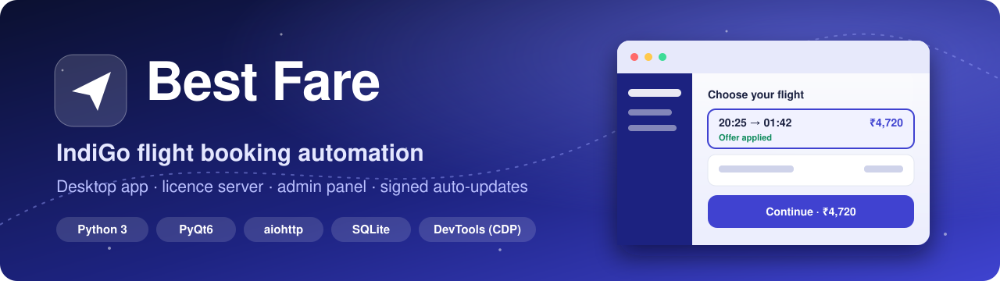

# Best Fare — IndiGo flight booking automation

**A Windows desktop app that turns a repetitive IndiGo booking into one click — plus the licence server, admin panel and signed auto-update system that run it as a real product.**


[**Watch the tour**](#-product-tour) · [**Features**](#-features) · [**How it works**](#-how-it-works) · [**Try it in 2 minutes**](#-try-it-in-two-minutes) · [**Admin panel**](#-live-links) · [**Security**](#-security-model)

</div>

---

## ✨ What is this?

Travel agents book IndiGo tickets all day: search, compare, apply a promotional fare, type every traveller's name, wait for the PNR — again and again.
**Best Fare does the whole sequence for them.** The agent fills in four boxes, picks a flight from a list that shows the lowest fare of each, and a few seconds later has a **PNR on a 30-minute hold**, already checked against IndiGo's own record of the booking. The agent then pays on IndiGo's website, as usual — **the app never submits a payment.**

This repository is the complete product, not just the automation:

| Part | What it is | Folder |
|---|---|---|
| 🖥️ **Desktop app** | PyQt6 window that books on the agent's own computer with its own private Edge. A small signed *shell* downloads the rest of the program, encrypted, after the licence is accepted | [`bestfare-desktop/`](bestfare-desktop) |
| ☁️ **Licence server + admin panel** | aiohttp + SQLite server that decides *who may book*: keys, credits, one-computer rule, offers, refunds, releases — with a plain-JS admin panel on top | [`bestfare-cloud/`](bestfare-cloud) |
| ⚙️ **Booking engine** | The shared IndiGo flow (search → fare hold → travellers → PNR), human-paced, with self-healing retries; also used by the original Telegram bot | [`indigo-bot/`](indigo-bot) |

## 🎬 Product tour

<p align="center">
  <a href="https://portfolio.shizanvps.me/projects/bestfare-indigo-flight-booking-automation">
    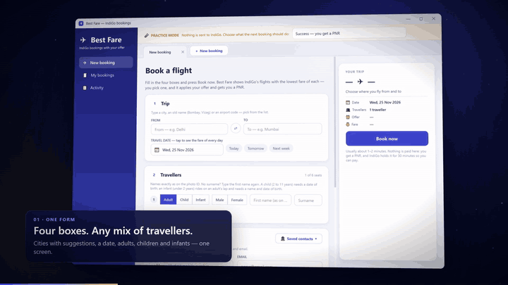
  </a>
  <br><sub>▶ Preview — <a href="https://portfolio.shizanvps.me/projects/bestfare-indigo-flight-booking-automation"><b>watch the full 80-second tour</b></a> (the real app in practice mode, from the form to the PNR)</sub>
</p>

## 📸 Screenshots

Everything below is the real application in **practice mode** (made-up fares and names; nothing is sent to IndiGo).

<table>
<tr>
<td width="50%">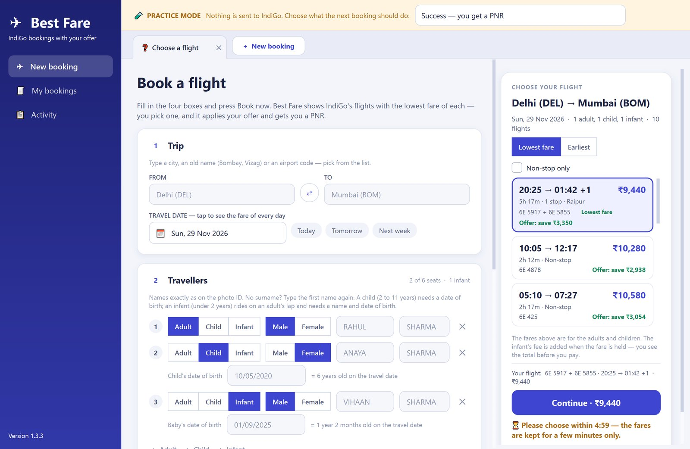<br><sub><b>Choose your flight</b> — every flight with its lowest fare; the offer is applied for you</sub></td>
<td width="50%">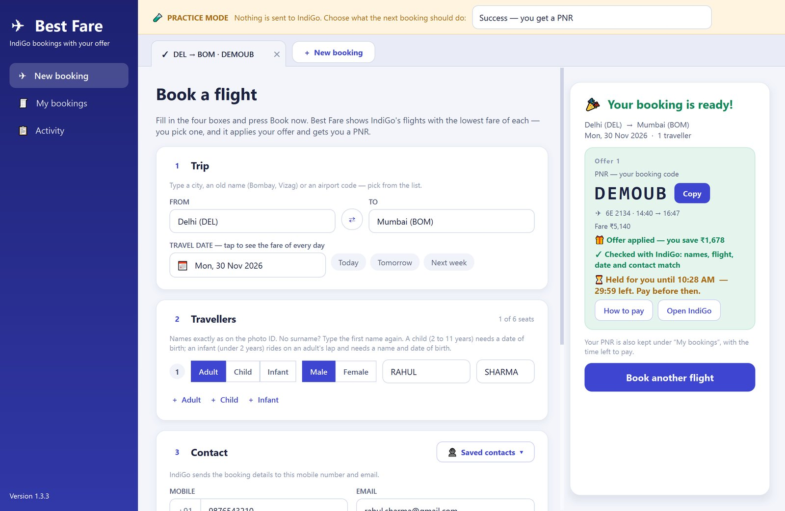<br><sub><b>Your PNR</b> — checked against IndiGo's own record, with the hold timer</sub></td>
</tr>
<tr>
<td>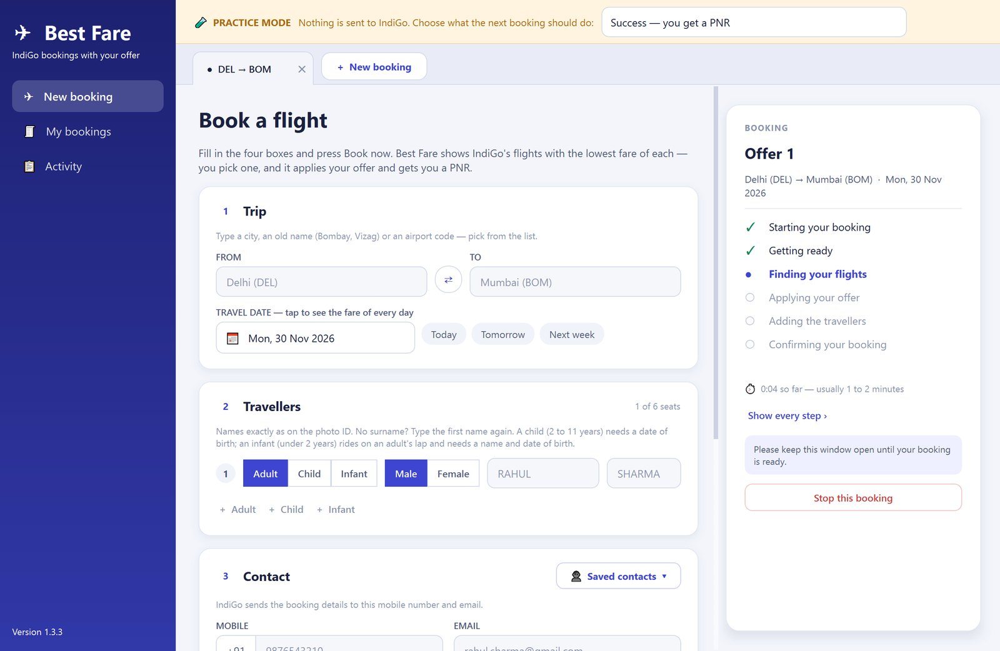<br><sub><b>Plain-language progress</b> — no technical words for the agent to decode</sub></td>
<td>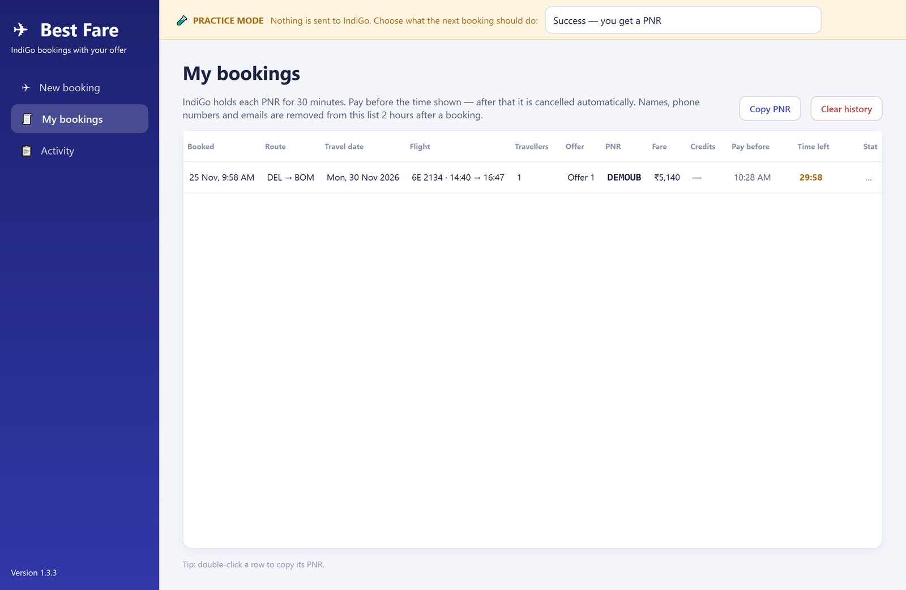<br><sub><b>My bookings</b> — live countdown to the end of every hold</sub></td>
</tr>
</table>

<details>
<summary>More screens</summary>

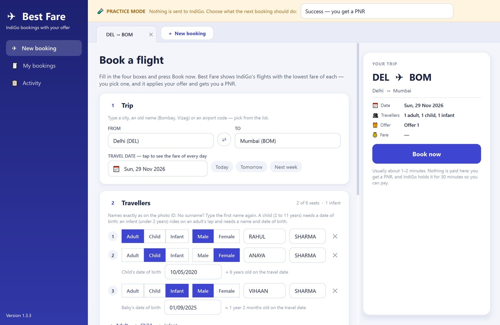 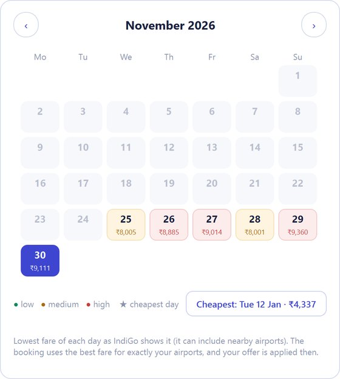
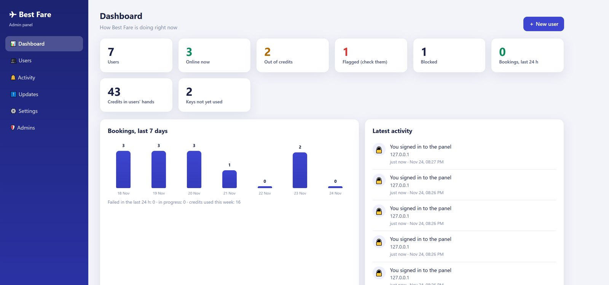 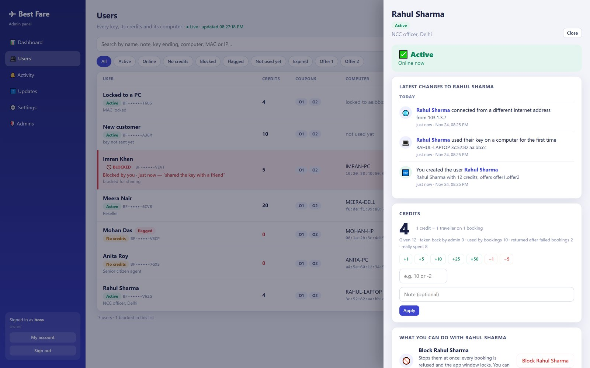
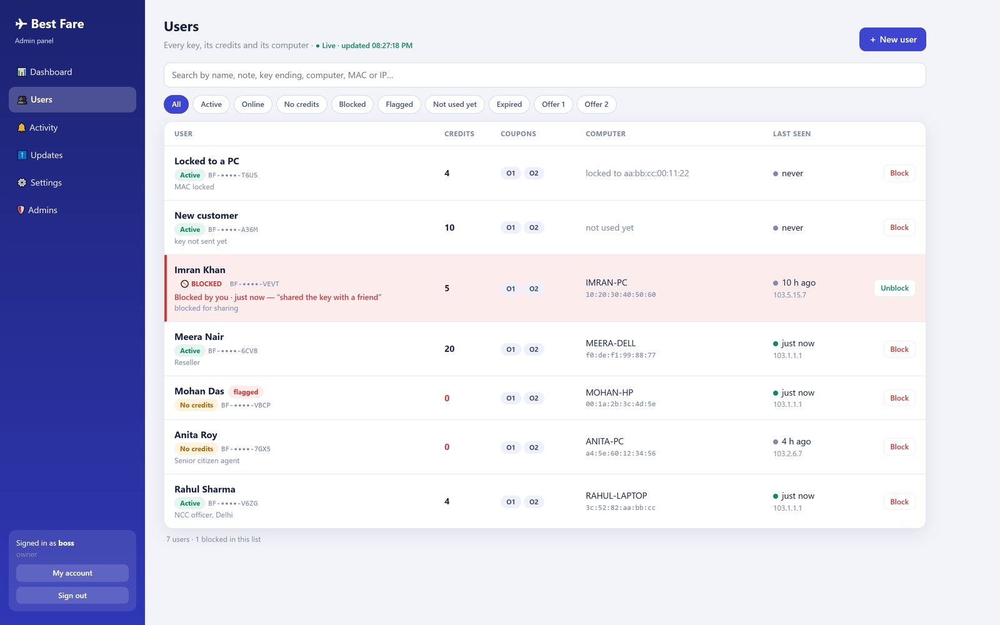 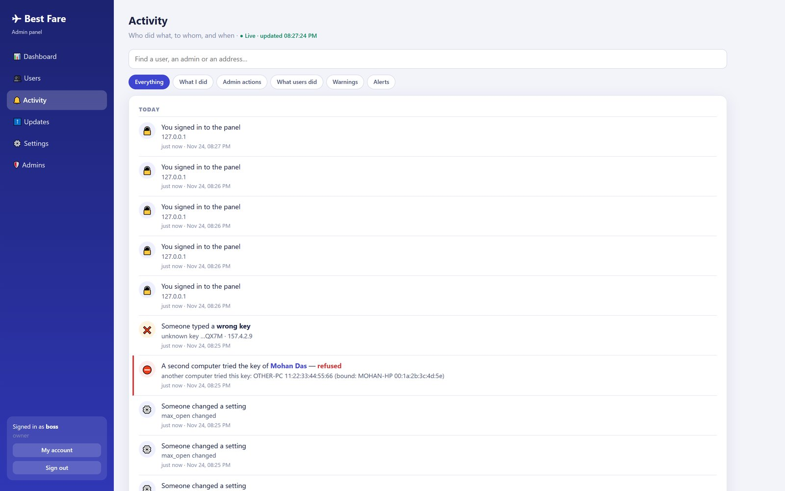

<sub>The admin panel (last four): who is online, who ran out of credits, block / reset computer / new key / refund — demo data.</sub>

</details>

## 🚀 Features

### The desktop app
- **One form, one click** — From / To with suggestions from IndiGo's own airport list (old names like *Bombay* and *Vizag* work), travel date, travellers, contact, offer.
- **Fare calendar** — the lowest fare of every day, the way IndiGo's own date picker shows it.
- **Choose your flight** — every flight with its lowest fare; the booking holds *exactly* the one you tap.
- **Adults, children and infants** — IndiGo's own rules (age on the day of travel, infants on an adult's lap), including the date-of-birth checks.
- **A real PNR in seconds** — a 30-minute hold, then **verified against IndiGo's own booking record** (names, route, date, contact) so a typo is caught while it can still be fixed.
- **Several bookings at once** — one tab per booking; a second booking waits its turn and starts by itself.
- **Self-healing** — when IndiGo hesitates the app retries calmly, with a fresh browser if needed, and says so in plain words. No lock-outs, no "wait 15 minutes" timers.
- **Practice mode** (`--demo`) — every screen and every failure works with made-up data. Nothing leaves the computer.
- **Light and responsive** — about 75 MB of memory; fits any screen from 820×500 upwards, remembers where you left the window.
- **Real Windows installer** — setup wizard, per-user install, update window with rollback, clean uninstall.

### The licence server and admin panel
- **Keys, credits, offers** — 1 credit = 1 traveller in 1 booking; credits are taken *before* the app is given an offer code and returned automatically when a booking fails (with abuse limits).
- **One key = one computer** — a second computer is refused and flagged.
- **Block / Unblock / Reset computer / New key / Delete** — each asks first, names the user, and the running app obeys within seconds (the window locks).
- **Releases** — publish a new version of the program to every installed app; a mandatory flag and rollout percentage.
- **Everything is logged** — an activity feed with alerts, credit history, who did what.
- **Owner / admin roles, optional two-step sign-in (TOTP), login throttling.**

### Engineering details worth a look
- **Shell + encrypted program.** The installed app is a tiny signed shell. The real program is downloaded only after the server accepts the key, **signed with the developer's offline release key, encrypted per user**, and run from memory. A leaked server cannot push code to the apps ([`bestfare-cloud/SECURITY.md`](bestfare-cloud/SECURITY.md)).
- **Raw DevTools protocol** — the booking browser is a normal Edge with its own profile, driven over a minimal CDP client; no automation framework footprint.
- **Human pacing** — natural pointer movement while the agent fills the form, calls spaced like a person's.
- **Shadows without cost** — card shadows are painted once into a small cached picture; a blinking cursor no longer re-blurs a whole card (5× less CPU than the Qt effect it replaced).
- **Responsive without breakpoints hacks** — rows measure their own room and choose one line or two (with hysteresis so a scrollbar can't flip them back and forth).
- **Tested for the way it actually fails** — 547 app tests and 222 server tests, including a red-team suite (replay, forged keys, wrong-key flooding, tampered releases), a real-window admin→app walk, and offscreen UI layout tests at five screen sizes.

## 🧩 How it works

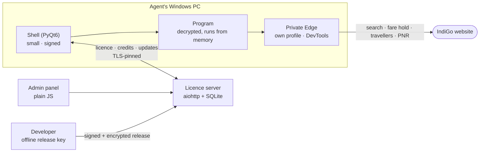

**One booking, end to end**

1. The agent presses **Book now**. The server is asked *once* whether this key may book and takes the credits.
2. The app shows the flights IndiGo has for the trip (each with its lowest fare) and waits for the agent's choice.
3. The program holds that exact fare with the offer applied, adds the travellers and the contact.
4. IndiGo's own payment page is used to create the hold and the **PNR** is read from IndiGo's booking record.
5. The record is compared with what was typed; the agent sees **Checked with IndiGo**, the PNR and the time left to pay. If anything failed, the credits go back automatically.

## ⚡ Try it in two minutes

Practice mode needs no IndiGo account, no licence key and sends nothing anywhere.

```powershell
git clone https://github.com/shizan52/bestfare-indigo-flight-booking-automation.git
cd bestfare-indigo-flight-booking-automation
python run.py --demo        # creates its own virtual environment on first start, then opens the app
```

```powershell
python run.py --tests                                              # the desktop app's tests
cd bestfare-cloud
..\bestfare-desktop\.venv\Scripts\python.exe tools_demo_server.py 8791
# → http://127.0.0.1:8791/admin/   a throw-away admin panel with made-up users (its demo login is printed at the top of tools_demo_server.py)
```

> Windows 10/11 and Microsoft Edge are required for the app. The server runs anywhere Python runs.

## 🔐 Security model

| Concern | How it is handled |
|---|---|
| Who may book | Server decides at the moment of booking; blocked, ended or moved keys lock the window |
| Leaked key | *New key* kills the old one; the computer must activate again |
| Code delivery | Signed by the developer's offline Ed25519 key, encrypted for the user (X25519 + AES-GCM) — the server only stores and serves |
| Man in the middle | The app pins the server's identity; every answer is signed |
| Admin accounts | Owner / admin roles, scrypt password hashing, optional TOTP, login throttling |
| Offer codes | Live only on the server; never inside the app, never in a release |
| Customer privacy | Names, phone numbers and e-mails are wiped from the history 2 hours after a booking |

The full threat model and what was attacked is in [`bestfare-cloud/SECURITY.md`](bestfare-cloud/SECURITY.md).

## 🗂️ Repository layout

```
bestfare-desktop/   the desktop app            README.md has the details
  main_window.py      the window: booking tabs, flight choice, results, history
  widgets.py          self-fitting rows, fare calendar, traveller rows
  engine.py           the booking worker: queue, self-healing, progress in plain words
  browser.py          the private Edge: start, repair, tidy, trim
  shell*.py, trust.py, updater.py, packed.py   the shell: licence, signed + encrypted program
  tools/              release building, installer, e2e tests, picture tools
bestfare-cloud/     the licence + admin + update server   README.md, SECURITY.md
  bfcloud/            service.py (all rules), web.py (HTTP), crypto.py, bundle.py, web/ (the panel)
indigo-bot/         the shared IndiGo engine (cdp, human, indigo_client, psp_flow, coupons)
docs/               README pictures
```

## 🌐 Live links

| | |
|---|---|
| 🛠️ **Admin panel** | **https://bestfare-admin.shizanvps.me/** — sign-in required (the credentials are private) |
| 🎞️ **Video tour & case study** | **https://portfolio.shizanvps.me/projects/bestfare-indigo-flight-booking-automation** |

## ⚖️ Notes

- **Not affiliated with IndiGo (InterGlobe Aviation).** *IndiGo* is a trademark of its owner; it is named here only to say which website the software works with.
- The app **never pays** for anything. It stops at a hold and the person pays on IndiGo's own site.
- Published as a **portfolio / code-review showcase** — see [LICENSE](LICENSE): you may read and run it for personal evaluation; commercial use or redistribution needs written permission.
- No real customer data, keys or offer codes are in this repository: the screenshots are practice mode and demo data, and the offer codes in the source and tests are placeholders.
- Please use any airline automation in line with that airline's terms of service.

## 👤 Author

Built and run by **Shizan** — [portfolio](https://portfolio.shizanvps.me/) · [GitHub @shizan52](https://github.com/shizan52)
